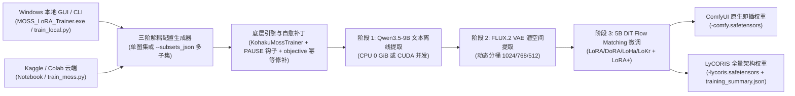

# OpenMOSS MOSS-Image Dual-Track LoRA Training Pipeline

[](https://github.com/abysschaos/kaggle-moss-lora-pipeline/releases/latest)
[](./LICENSE)
[](https://huggingface.co/KBlueLeaf/MOSS-Image-heal)
[](https://github.com/KohakuBlueleaf/KohakuMossTrainer)
[](#快速开始-quickstart)

> 一套面向 **OpenMOSS MOSS-Image (5B Single-Stream DiT)** 的双轨 LoRA / DoRA / LoHa / LoKr 自动化训练与工程调度方案，基于 [KohakuBlueleaf/KohakuMossTrainer](https://github.com/KohakuBlueleaf/KohakuMossTrainer) 构建，全面兼顾 **Windows 消费级显卡（6GB~16GB VRAM）零黑框图形化极速炼丹** 与 **Kaggle / Colab 云端免费 GPU 自动化流水线**。

---

## 目录 (Table of Contents)

- [项目定位与核心特性](#项目定位与核心特性)
- [系统架构与双轨数据流](#系统架构与双轨数据流)
- [双轨硬件与效率对比](#双轨硬件与效率对比)
- [快速开始 (Quickstart)](#快速开始-quickstart)
- [详细使用指南](#详细使用指南)
- [配置项与环境变量](#配置项与环境变量)
- [ComfyUI 官方原生推理规范](#comfyui-官方原生推理规范)
- [项目目录结构](#项目目录结构)
- [核心技术文档体系](#核心技术文档体系)
- [常见问题与排错指引](#常见问题与排错指引)
- [开发与贡献指南](#开发与贡献指南)
- [致谢与开源许可证](#致谢与开源许可证)

---

## 项目定位与核心特性

在消费级显卡（如 8GB VRAM 的 RTX 4060 / 4070 Laptop）或免费云端容器（Tesla T4 16GB）上微调 50 亿参数的 MOSS-Image 单流 DiT 与 9B Qwen3.5 文本编码器，容易遭遇联合加载显存溢出（>22 GB）、PyTorch 动态库脱节、Windows Triton 中文路径解码失败以及半精度残差尖峰溢出。本项目在不修改原生权重格式的前提下，将环境治理、三阶解耦调度、多子集配比与视觉化监控打包为开箱即用的双轨工程系统。

- **全谱系底模与显存弹性档位**：本地与云端双轨同步支持 `MOSS-Image-Base`、`MOSS-Image-heal` 与 `MOSS-Image-SFT` 三大变体自动探测，提供 `auto / 6g / 8g / 12g / 16g` 五档显存配置与 `1024 / 768 / 512` 动态分桶分辨率；对非 Heal 底模的 FP16 训练自动注入 `FP16_FIX="online"` 与 `FP16_FIX_KWARGS={"c": 1/16}` 防溢出系数。
- **三阶时序解耦与零重复消费下载**：支持全盘宽域扫描并零拷贝复用现有 ComfyUI 模型库，按需路由 Qwen3.5-9B 至主机内存执行 CPU 离线文本特征提取（显存占用 0 GiB），随后由 GPU 提取 FLUX.2 VAE 潜向量并释放，最终在仅载入 5B DiT 与轻量适配器的状态下完成高精度微调。
- **原生零黑框 Windows 桌面控制台与实时监控看板**：内建开源可审计 C# 启动器 [MossTrainerLauncher.cs](launcher/MossTrainerLauncher.cs)，1 秒无第三方依赖编译为约 80KB 的 `MOSS_LoRA_Trainer.exe`；配备深色宽屏界面、纯原生 `tk.Canvas` 实时 Loss / EMA 折线图、4 枚 KPI 卡片与独立任务栏图标分组。
- **全场景断点续炼与中途暂停存盘**：支持 `fresh / resume / init_from` 三大训练模式、读取 `safetensors` 头部自动对齐已有架构、训练中途随时点击【暂停并存盘】安全退出并保留权重，以及每 10 秒后台增量同步导出产物到专属目录与 ComfyUI `models/loras/`。
- **多子集配比与高阶适配器引擎**：支持单任务混合多个独立人物、画风或概念子目录，按子集独立注入触发词与 `Repeat` 权重，并提供【一键配平 Repeat】自动按图数反比对齐单轮曝光；双轨原生开放 `LoRA / LoHa / LoKr`、`DoRA`（自动配对 `DORA_DETACH=True`）、`LoRA+` 与 6 档 Transformer 注入层预设。

---

## 系统架构与双轨数据流



---

## 双轨硬件与效率对比

| 评估维度 | 模式 A：云端 Kaggle / Colab 自动化 | 模式 B：Windows 本地消费级显卡极速模式 |
| :--- | :--- | :--- |
| **目标硬件** | Tesla T4 / P100 (16GB) / Colab L4 / A100 | RTX 4070 / 4060 / 3060 / 2060 (6GB ~ 16GB VRAM) |
| **计算精度** | `auto` 智能嗅探（T4 自动 FP16 + 防溢出，L4/A100 用 BF16） | 原生硬件级 BF16（Turing 显卡自动平滑回退 FP16） |
| **显存档位与分辨率** | 支持 `auto / 6g / 8g / 12g / 16g` 与 `1024 / 768 / 512` | GUI / CLI 自由切换显存档位与目标分辨率 |
| **底模变体支持** | `heal` / `base` / `sft` 全谱系，支持 `int8` 与全精度自动拉取 | 自动探测并直连现有本地 `Base` / `Heal` / `SFT` 文件 |
| **单步实测参考速度** | ~42 秒 / step (1024) 或 ~24 秒 / step (768, T4) | ~7 - 9 秒 / step (RTX 40 系列, 提速约 4.5 倍) |
| **模型资产依赖** | 从 HuggingFace 按所选变体与量化规格高速拉取 | 优先零拷贝复用本机 ComfyUI 模型库，无需重复下载 |
| **标准入口** | [notebooks/kaggle_moss_lora_training.ipynb](notebooks/kaggle_moss_lora_training.ipynb) 或 `.\scripts\push_to_kaggle.ps1` | `MOSS_LoRA_Trainer.exe`（由 [build_exe.bat](build_exe.bat) 1 秒编译）或 [launch_ui.vbs](launch_ui.vbs) |

---

## 快速开始 (Quickstart)

> **路径避坑铁律**：Windows 本地运行请务必将仓库解压或克隆至**纯英文且无空格**的磁盘路径（如 `D:\kaggle_moss_lora_pipeline\`），避免 PyTorch C++ 算子或 Triton 解码发生路径异常。

### 方式一：Windows 本地极速上手（3 步零黑框启动）

#### 1. 获取项目代码与发行工具
- **推荐下载压缩包**：前往 [GitHub Releases 最新稳定版 (v1.2.2)](https://github.com/abysschaos/kaggle-moss-lora-pipeline/releases/latest) 获取源代码包与预编译的 `MOSS_LoRA_Trainer.exe`（可对照同页 `SHA256SUMS.txt` 校验），或直接下载 [主分支 ZIP](https://github.com/abysschaos/kaggle-moss-lora-pipeline/archive/refs/heads/main.zip)。
- **Git 命令行克隆**：
  ```bash
  git clone https://github.com/abysschaos/kaggle-moss-lora-pipeline.git
  cd kaggle-moss-lora-pipeline
  ```

#### 2. 环境就绪与原生启动器构建
- **若本机已安装 ComfyUI 便携版 / 独立 CUDA Python**：无需新建环境，启动器会自动全盘探测并直接复用现有 PyTorch 环境。
- **若为全新纯净 Windows 系统**：双击根目录 [install_windows.bat](install_windows.bat)（或运行 `.\scripts\install.ps1`），脚本将自动构建隔离 `venv`、安装 CUDA 12.4 PyTorch、补齐 `requirements-local.txt` 并生成 `models/` 与 `KohakuMossTrainer/` 存放说明。
- **编译本地 `.exe` 启动器（1 秒透明编译，无需 PyInstaller）**：双击根目录 [build_exe.bat](build_exe.bat)（或运行 `.\scripts\build_exe.ps1 -CreateDesktopShortcut`），系统会调用 Windows 自带的 `.NET Framework 4.x csc.exe` 从源码生成 `MOSS_LoRA_Trainer.exe`。

#### 3. 选择适合你的启动入口

| 启动入口 | 类型 | 核心定位与适用场景 | 是否弹黑框 |
| :--- | :--- | :--- | :--- |
| **`MOSS_LoRA_Trainer.exe`** | 原生 WinExe 启动器 | **日常桌面首选**：1 秒由源码透明编译，带多分辨率图标、可固定 Windows 任务栏、内置高速 PyTorch 直达通道 | 否（全链路静默） |
| [launch_ui.vbs](launch_ui.vbs) | Windows Script Host | **免编译备选**：未执行 `build_exe.bat` 时直接双击使用，后台静默拉起 `silent_launcher.pyw` 与 GUI | 否 |
| [launch_ui.bat](launch_ui.bat) | 批处理兼容入口 | 用于双击习惯或快捷脚本中转，自动转交 `launch_ui.vbs` 后立即关闭窗口 | 极短闪关 / 否 |
| [scripts/run_local.ps1](scripts/run_local.ps1) | 交互式 PowerShell CLI | **终端/无人值守调试**：快速检测显卡与默认图集后直接敲回车或输入 `custom` 跑 CLI | 是（终端模式） |

打开图形控制台后，选择图集文件夹（或在卡片内启用【多子集配比模式】）、在顶部一键套用五大实战模板（`艺术画风 / 单人角色 / 多人物配比 / 多画风配比 / 概念与动作`），点击【🚀 启动本地极速训练】即可在右侧实时看板观察 Loss / EMA 曲线，训练完成后权重将自动存入 `output/<lora_name>/` 并可一键推送至 `ComfyUI/models/loras/`。

---

### 方式二：Kaggle 云端免费部署（无需本地 GPU）

1. 将本地图片与同名 `.txt` 自然语言标注打包为 ZIP，在 Kaggle 创建私有 Dataset（**+ Create -> New Dataset**）。
2. 新建 Notebook，开启 **GPU T4 x1** 与 **Internet on**，挂载私有数据集。
3. 导入仓库中的 [notebooks/kaggle_moss_lora_training.ipynb](notebooks/kaggle_moss_lora_training.ipynb)，修改顶部的 `LORA_NAME`、`TRIGGER_WORD`、`ALGO`、`USE_DORA`、`SUBSETS_JSON` 等参数后运行全部单元格，结束后直接在右侧 **Output** 面板下载 `{LORA_NAME}_lora_results.zip`。完整图文说明见 [docs/kaggle_deployment_guide.md](docs/kaggle_deployment_guide.md)。

---

## 详细使用指南

### 1. 本地 CLI 标准调用示例 ([train_local.py](train_local.py))

```powershell
# 查看当前版本
python train_local.py --version

# 常规单图集 + DoRA + 8GB 显存档位训练
python train_local.py `
    --data_dir "./dataset/my_char" `
    --lora_name "my_char_dora_v1" `
    --trigger_word "my_char" `
    --repeats 6 `
    --epochs 4 `
    --steps 400 `
    --rank 32 `
    --alpha 16.0 `
    --algo lora `
    --dora `
    --target_preset attn-mlp+text-refiner `
    --loraplus_ratio 2.0 `
    --vram_preset 8g `
    --resolution 1024 `
    --precision bf16 `
    --text_device cpu `
    --copy_to_comfy_loras
```

### 2. 多子集配比调用示例（多人物 / 多画风 / 概念均衡）

准备一个 JSON 配置文件（或直接传入 JSON 数组字符串），指定各子集名称、独立目录、专属触发词与独立重复倍率：

```json
[
  {"name": "char_alice", "path": "D:/datasets/alice", "trigger": "alice_char", "repeats": 6, "enabled": true},
  {"name": "char_bob",   "path": "D:/datasets/bob",   "trigger": "bob_char",   "repeats": 12, "enabled": true}
]
```

```powershell
python train_local.py `
    --subsets_json "./subsets.json" `
    --lora_name "duo_alice_bob" `
    --steps 800 `
    --rank 48 `
    --alpha 48.0 `
    --algo lora `
    --dora `
    --target_preset attn-mlp+text-refiner `
    --loraplus_ratio 2.0 `
    --copy_to_comfy_loras
```

> 本地 31 个 CLI 开关与云端 27 个 CLI / 环境变量参数全表，请参阅 [docs/parameter_configuration_reference.md](docs/parameter_configuration_reference.md)。

### 3. 断点续炼与已有 LoRA 继续微调

- **继续中断任务 (`resume`)**：`--train_mode resume --resume_from latest`（或指向具体 `step_XXXXXXXX` 目录），程序会自动顺延剩余步数。
- **基于已完成权重二次强化 (`init_from`)**：`--train_mode init_from --init_from "./output/my_lora/my_lora-comfy.safetensors"`，系统自动嗅探权重文件中的 `LoRA / LoHa / LoKr`、`DoRA`、`Rank / Alpha` 与 `PRESET` 对齐初始化。

---

## 配置项与环境变量

本仓库提供完整脱敏的环境变量模板 [.env.example](.env.example)，包含本地路径指针与云端全量环境开关。以下列出高频关键环境变量：

| 变量名 | 默认值 | 适用脚本 | 核心作用说明 |
| :--- | :--- | :--- | :--- |
| `COMFYUI_PYTHON` | 自动探测 | `MossTrainerLauncher` / `silent_launcher` / `run_local.ps1` | 显式指定本地 ComfyUI `python.exe` 绝对路径 |
| `COMFYUI_PATH` / `COMFYUI_MODELS` | 自动探测 | `train_local.py` | 指定本机 ComfyUI 根目录或 `models/` 路径，优先级高于全盘扫描 |
| `HF_TOKEN` | 空 | 云端 `train_moss.py` | 加速拉取 HuggingFace 权重并降低限流概率 |
| `MODEL_VARIANT` | `heal` | `train_moss.py` | 指定云端底层权重分支：`heal` / `base` / `sft` |
| `VRAM_PRESET` | `auto` | `train_moss.py` | 云端显存档位：`auto` / `6g` / `8g` / `12g` / `16g` |
| `ALGO` / `USE_DORA` | `lora` / `false` | `train_moss.py` | 控制低秩算法（`lora`/`loha`/`lokr`）与 DoRA 开关 |
| `TARGET_PRESET` / `LORAPLUS_RATIO` | `attn-mlp` / `1.0` | `train_moss.py` | Transformer 注入层预设与 LoRA+ 上投影学习率倍率 |
| `SUBSETS_JSON` | 空 | `train_moss.py` | 多子集配比 JSON 数组或文件路径 |

---

## ComfyUI 官方原生推理规范

将导出的 `<lora_name>-comfy.safetensors` 放置于 `ComfyUI/models/loras/` 目录下，使用标准 `Load LoRA` 节点加载（对于 DoRA / LoHa / LoKr 权重同样可由现代 ComfyUI 与 `LycorisLoader` 加载；训练器内部已强制锁定 `SAVE_FUSED_QKV = False` 保持紧凑键名）：

| 推理参数 | 官方推荐值 | 错误设定风险 |
| :--- | :--- | :--- |
| **LoRA Strength Model** | `0.6 ~ 0.8` | 过高易牺牲提示词泛化能力 |
| **CFG Guidance** | `3.0 ~ 3.5` | 严禁设为 `7.0+`，否则画面瞬间过饱和发黑 |
| **Sampler / Scheduler** | **Flow-matching Euler** + **Shift = 5.0** | 使用 Karras / DPM++ 易导致轨迹偏移或局部糊化 |
| **Steps** | `>= 50` 步 | 步数过低无法完成连续速度场积分 |
| **Negative Prompt** | **留空 (Empty)** | 填入传统负面套话会破坏无分类器引导动力学分布 |
| **Trigger Example** | 自然语言前导，如 `A digital anime illustration of ..., in the style of <trigger>` | 遵循 MOSS-Image 自然语言散文风格分布 |

更多 ComfyUI 节点与原理细节，请参阅 [docs/comfyui_inference_guide.md](docs/comfyui_inference_guide.md)。

---

## 项目目录结构

```text
kaggle_moss_lora_pipeline/
├── VERSION                                    # 单一版本信源 (1.2.2)
├── LICENSE                                    # Apache License 2.0 开源协议
├── CHANGELOG.md                               # Keep a Changelog 1.1.0 演进记录
├── README.md                                  # 项目主文档与全双轨操作指南
├── CONTRIBUTING.md                            # 研发规范、提交约定与自检清单
├── SECURITY.md                                # 安全策略与敏感文件隔离说明
├── .env.example                               # 本地与云端全量环境变量脱敏模板
├── .gitignore                                 # 严格过滤权重、个人配置、缓存与构建产物
├── kernel-metadata.json                       # Kaggle CLI 推送元数据配置
├── requirements.txt                           # 云端辅助工具依赖清单
├── requirements-local.txt                     # 本地 Windows 辅助训练依赖清单
├── install_windows.bat                        # Windows 本地一键创建 venv 与 CUDA 依赖部署
├── build_exe.bat                              # 1 秒本地编译 MOSS_LoRA_Trainer.exe 批处理入口
├── launch_ui.vbs                              # 免编译 Windows 零黑框原生桌面启动器
├── launch_ui.bat                              # Windows 启动兼容入口 (转交 launch_ui.vbs 后秒关)
├── gui_local.py                               # 深色宽屏本地控制台 (多子集看板 / Loss 曲线 / 暂停续炼)
├── train_local.py                             # Windows 消费级显卡本地训练执行引擎
├── train_moss.py                              # Kaggle / Colab 云端自动化训练执行引擎
├── .github/
│   ├── ISSUE_TEMPLATE/
│   │   ├── bug_report.yml                     # 结构化 Bug 反馈表单
│   │   └── feature_request.yml                # 结构化功能建议表单
│   └── PULL_REQUEST_TEMPLATE.md               # PR 提交与自检核对清单
├── assets/
│   └── moss_trainer.ico                       # 16px~256px 6 档超采样应用图标
├── launcher/
│   └── MossTrainerLauncher.cs                 # 开源可审计 Windows C# WinExe 启动器源码
├── notebooks/
│   └── kaggle_moss_lora_training.ipynb        # Kaggle 纯网页端开箱即用 Notebook 模板
├── scripts/
│   ├── build_exe.ps1                          # 调用 .NET csc.exe 编译启动器 (支持 -EmitChecksum)
│   ├── generate_icon.py                       # 超采样应用图标生成工具
│   ├── silent_launcher.pyw                    # 零黑框全盘环境探测与 GUI 拉起脚本
│   ├── install.ps1                            # PowerShell 版环境自动安装脚本
│   ├── run_local.ps1                          # PowerShell 交互式 CLI 启动脚本
│   ├── detect_env.py                          # ComfyUI Python 环境轻量探测器
│   ├── push_to_kaggle.ps1                     # 一键推送任务至 Kaggle 云端后台
│   ├── pull_weights.ps1                       # 一键拉回 Kaggle 云端产出权重
│   └── sync_github_release.ps1                # GitHub 仓库元数据与 Releases/资产同步脚本
└── docs/
    ├── local_installation_guide.md            # Windows 本地安装、底模下载与零拷贝复用指南
    ├── local_deployment_guide.md              # 消费级显卡 8GB 显存解耦与 BF16 原理白皮书
    ├── kaggle_deployment_guide.md             # Kaggle 纯网页端与 CLI 自动化操作手册
    ├── parameter_configuration_reference.md   # 本地 31 项与云端 27 项参数速查与 JSON 范例
    ├── hyperparameter_tuning_guide.md         # 画风/人物/多子集/DoRA/LoHa/LoKr 超参数调优指南
    ├── dit_flow_matching_guide.md             # 5B DiT 连续流匹配与 Token Packing 数学模型
    ├── comfyui_inference_guide.md             # ComfyUI 原生节点配置与 SLG 推理规范
    ├── troubleshooting_matrix.md              # 25 个迭代沉淀的排错矩阵与底层根因实录
    └── github_release_workflow_template.yml   # GitHub Actions 自动编译与 Release 工作流参考模板
```

---

## 核心技术文档体系

1. [Windows 本地部署与环境安装完全手册](docs/local_installation_guide.md)：硬件门槛、一键虚拟环境部署、底模存放路径与现有 ComfyUI 资产零拷贝复用。
2. [消费级显卡显存控制与 BF16 深度指南](docs/local_deployment_guide.md)：详解三阶时序解耦、CPU 文本路由、显存挡位（`6g/8g/12g/16g`）与多分辨率权衡。
3. [Kaggle 云端部署与自定义训练完全手册](docs/kaggle_deployment_guide.md)：纯网页三步挂载、全参数内联脚本与 CLI 无头投递拉取流程。
4. [全量参数调节位置与 CLI / 环境变量速查手册](docs/parameter_configuration_reference.md)：精准对照 `train_local.py` 与 `train_moss.py` 全量开关、多子集 JSON 格式与默认配置文件生成位置。
5. [超参数调优与高阶适配器实战指南](docs/hyperparameter_tuning_guide.md)：涵盖画风 vs 人物差异、多子集 Repeat 均衡、DoRA / LoHa / LoKr / LoRA+ 与生物特征剪枝（Token Pruning）。
6. [5B DiT 与 Flow Matching 训练工程理论](docs/dit_flow_matching_guide.md)：连续流速度场微调、`MAX_TOKENS=16384` Token Packing 步数公式与底模 `heal` 平滑依据。
7. [ComfyUI 官方原生推理规范与避坑指南](docs/comfyui_inference_guide.md)：CFG 3.0~3.5、Shift 5.0、SLG 跳层 22 与 `lora_unet_` 键名映射解析。
8. [全流程排障实录与错误矩阵](docs/troubleshooting_matrix.md)：涵盖 TorchVision C++ 算子脱节、PyTorch 2.11 `empty_host_cache` 兼容、Flow Matching 假性收敛等 17 项真实故障诊断与修复方案。
9. [完整版本变更日志](CHANGELOG.md)：严格遵循 Keep a Changelog 1.1.0 规范记录各版本演进与 Git 对比链接。

---

## 常见问题与排错指引

- **Windows 报错 `UnicodeDecodeError` 或 Triton 缓存失败**：确保项目根目录、数据集路径与输出路径均不含中文与空格；引擎默认已自动强制绑定 `C:/tmp/moss_pipeline` 作为安全临时与 Triton 缓存根目录。
- **训练初期 Loss 迅速下降但出图几乎看不出 LoRA 效果**：MOSS-Image (5B DiT) 具备极强原生先验，且引擎采用 Token Packing（1 步 ≈ 4 图），需保证单图等效遍历与目标 Alpha（建议画风 `Alpha = Rank`，人物 `Alpha = 0.5 * Rank ~ Rank`，步数参照公式对齐）。
- **显存只有 6GB 或 8GB 却加载全精度底模 OOM**：确认 GUI 或 CLI 设为 `--vram_preset 6g`（或 `auto`）与 `--text_device cpu`，优先使用 `int8` 量化 DiT 与 `768` 分辨率。
- **手动放置 `KohakuMossTrainer` 无法识别**：请确认源码直接位于根目录 `KohakuMossTrainer/` 下，即 `KohakuMossTrainer/pyproject.toml` 位于第一层，切忌保留 ZIP 解压出来的双层 `KohakuMossTrainer-main/` 套娃目录；点击 GUI 中的【🩹 检查并注入补丁】即可自动完成自愈修复。

---

## 开发与贡献指南

欢迎提交 Issue 与 Pull Request 改进本工程！提交代码或文档前请阅读 [CONTRIBUTING.md](CONTRIBUTING.md) 与 [SECURITY.md](SECURITY.md)，遵守 Conventional Commits、PowerShell 5.1 兼容性与隐私零泄露规范，并通过全部本地语法与启动器编译校验。

---

## 致谢与开源许可证

- **上游核心架构**：
  - [OpenMOSS-Team/MOSS-Image](https://github.com/OpenMOSS-Team/MOSS-Image) — 官方开源 5B Single-Stream DiT 视觉生成大模型与官方 `USERGUIDE.md` 推理基准（Apache-2.0）。
  - [KBlueLeaf/MOSS-Image-heal](https://huggingface.co/KBlueLeaf/MOSS-Image-heal) — 修复版 MOSS-Image 权重，大幅降低深层残差尖峰溢出现象。
  - [KohakuBlueleaf/KohakuMossTrainer](https://github.com/KohakuBlueleaf/KohakuMossTrainer) — 底层高性能训练引擎（遵循 Kohaku License 1.0；本管线通过运行时独立拉取调用，不在本仓库源码中混包分发其源代码）。
- **本项目授权协议**：
  本仓库自研脚本、UI 控制台、启动器及工程文档体系基于 [Apache License 2.0](./LICENSE) 开源发布。
